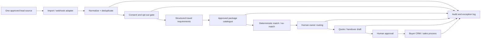

# Travel Revenue Automation — Architecture & Demo Walkthrough

## Architecture (pilot boundary)

## Data contract
Minimum lead fields:
- `lead_id` (stable source identifier)
- `source` and optional `campaign_id`
- `destination`, `travel_window`, `travellers`, `trip_days`, `budget_inr`
- `consent_status`, `opt_out`, `do_not_contact`
- `owner_id`, `stage`, `created_at`, `updated_at`

Package fields:
- `package_id`, `destination`, `name`, `price_per_person`, `duration_days`, `status`, `valid_from`, `valid_to`, `inclusions_ref`

Every field needs a source and freshness rule. Missing/expired/contradictory package facts must result in human review, not AI completion.

## Walkthrough using current synthetic demo
1. Load `samples/leads.csv`, `samples/packages.csv` and `samples/owners.json`.
2. Run the command in `README.md`.
3. Inspect each output record:
   - qualification result,
   - matched package IDs,
   - deterministic owner,
   - next action,
   - indicative quote draft,
   - follow-up suppression state.
4. Verify global control flags: messages_sent=false, booking_created=false, payment_verified=false, supplier_inventory_checked=false, human_approval_required=true.

## Important production gap register
- CSV-only demo input; no live ingestion adapter.
- Current prototype lacks persistent database, authenticated users and production audit store.
- Requirement extraction currently reads structured fields, not natural-language WhatsApp conversations or voice notes.
- Package matcher is deterministic and simple; it does not validate travel dates, taxes, occupancy, supplier stock or live rates.
- Owner assignment is deterministic demonstration routing, not workload-aware routing.
- Quote output is a draft; no quotation API connection.
- Booking state machine is a local guardrail, not a booking-system sync.
- Follow-up suppression is a local rule check; no scheduler or messaging integration.
- No production security, privacy, backup or availability claims are made.

## Recommended implementation sequence after buyer agreement
1. Confirm process/data map and threat model.
2. Add persistent data model and idempotent ingestion.
3. Implement one client-owned sandbox adapter.
4. Add consent provenance and suppression event history.
5. Add catalogue validation/versioning and package match explainability.
6. Add routing and human review queue.
7. Add quote API sandbox connector only if documented and included.
8. Add booking test import only if buyer provides an agreed test feed.
9. Run acceptance tests and security review.
10. Production release only after separate go-live checklist and written authorization.
